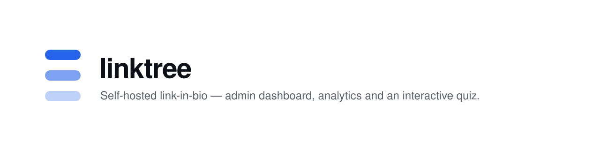
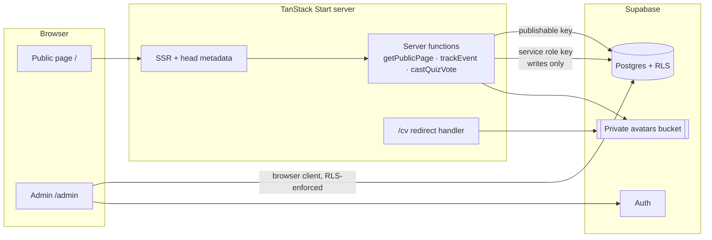

<picture>
  <source media="(prefers-color-scheme: dark)" srcset="assets/banner-dark.svg">
  <source media="(prefers-color-scheme: light)" srcset="assets/banner-light.svg">
  
</picture>

# linktree

A self-hosted link-in-bio application: a public profile page with grouped,
reorderable links, social icons and an interactive "Spot the AI" video quiz,
plus privacy-conscious click analytics — all managed through a built-in
admin dashboard backed by Supabase.


---

## Why

Hosted link-in-bio services own your audience data, limit customisation to
their templates, and gate analytics behind subscriptions. This project keeps
the entire surface — content, appearance, media and metrics — in
infrastructure you control:

- Content, theme and media live in your own Postgres database and storage
  bucket.
- Analytics record events, not people: no visitor PII is stored, and rate
  limiting uses day-salted hashes that are never persisted alongside events.
- The admin dashboard is the same app, not a separate product — one deploy,
  one codebase.

## Features

All features below are implemented in this repository.

**Public page (`/`)**

- Profile with avatar, headline, bio and per-profile accent colour
- Links grouped into categories, with drag-defined ordering, thumbnails and
  automatic favicon fallbacks
- Social icon row with per-platform icons
- "Spot the AI" quiz: video round, anonymous one-vote-per-visitor polling,
  server-side grading, and an admin-controlled answer reveal with vote totals
- Light/dark theme with visitor preference persisted in `localStorage`
- Server-rendered SEO and Open Graph metadata from the profile
- `/cv` — a stable URL that redirects to a short-lived signed link for the
  uploaded CV PDF

**Admin dashboard (`/admin`, behind sign-in at `/auth`)**

- Tabs for profile, appearance (theme, fonts, background, buttons, accent
  colour), links, categories, socials, quiz and analytics
- Drag-and-drop reordering of links and categories (dnd-kit)
- Image uploads to a private storage bucket, served via signed URLs
- Analytics view of views, clicks and referrer domains
- Live preview of the public page inside the dashboard

## Architecture



- The public page loads via the `getPublicPage` server function with the
  publishable key, keeping SSR and share metadata working without auth.
- The admin UI talks to the database directly from the browser; row-level
  security (`has_role(..., 'admin')`) is the security boundary.
- Analytics and quiz votes only flow through server functions with bot
  filtering and hashed rate limiting.
- The first account to sign up becomes admin via a database trigger; the
  sign-up UI hides once an admin exists.

## Technology stack

| Layer | Technology |
| --- | --- |
| Framework | TanStack Start 1.168 (SSR), TanStack Router 1.170, Nitro 3 |
| UI | React 19, Tailwind CSS 4, Radix UI primitives, lucide-react |
| Data | TanStack Query 5, Supabase JS 2 (Postgres, Auth, Storage) |
| Schema | Drizzle migrations (`drizzle/migrations/`) |
| Validation | Zod, react-hook-form |
| Charts | Recharts |
| Tooling | Bun 1, Vite 8, TypeScript 5.8, Vitest 4, ESLint 9, Prettier |
| Packaging | Docker — Bun build stage, Node 22 runtime |

## Quick start

Prerequisites: [Bun](https://bun.sh) 1.x (or Node 22+ with npm) and a
Supabase project with the migrations from `drizzle/migrations/` applied.

```sh
git clone https://github.com/samansalari/linktree.git
cd linktree
bun install --frozen-lockfile
cp .env.example .env   # then fill in your Supabase values
bun run dev            # http://localhost:8080
```

Server functions read `SUPABASE_URL` and `SUPABASE_PUBLISHABLE_KEY` from the
process environment; if they are not picked up from `.env` in your setup,
export them in your shell before starting the dev server.

## Configuration

| Variable | Scope | Required | Purpose |
| --- | --- | --- | --- |
| `VITE_SUPABASE_URL` | browser (build-time) | Yes | Supabase project URL in the browser bundle |
| `VITE_SUPABASE_PUBLISHABLE_KEY` | browser (build-time) | Yes | Publishable key for the browser client |
| `SUPABASE_URL` | server | Yes | Server-side Supabase URL |
| `SUPABASE_PUBLISHABLE_KEY` | server | Yes | Public-page reads via server functions |
| `SUPABASE_SERVICE_ROLE_KEY` | server | Optional | Enables analytics writes and quiz vote recording when self-hosting outside Lovable Cloud |
| `LOVABLE_DB_MIGRATION_URL` | tooling | Migrations only | Connection string used by drizzle-kit |

Never commit real values. `.env.example` contains placeholders only.

## Usage

- **Edit content** — sign in at `/auth`, then use the dashboard tabs. The
  first account created becomes admin automatically, so register your own
  account before sharing the URL.
- **Reorder links and categories** — drag the handles in the respective
  tabs; order is persisted to the database.
- **Run a quiz round** — upload a video, set two or three options and keep
  the answer hidden; reveal it (with vote totals) when the round ends.
  Changing the round resets one-vote-per-visitor enforcement.
- **Share your CV** — upload the PDF in the profile tab; it is served from
  the stable `/cv` path via a short-lived signed URL.

## Testing and validation

```sh
bun run test    # 13 tests across 3 files (Vitest + Testing Library, jsdom)
bun run build   # production build via Vite/Nitro
bun run lint    # ESLint 9 + Prettier
```

Status on this machine: install, dev server, tests and production build all
pass. `bun run lint` currently reports ~1,490 problems, the overwhelming
majority auto-fixable Prettier formatting — run `bunx prettier --write .`
before committing until this is cleaned up.

## Security considerations

- Row-level security is the authorisation boundary for all admin writes;
  the quiz answer lives in an admin-only table and is never sent to the
  browser — grading happens server-side.
- `SUPABASE_SERVICE_ROLE_KEY` is used only in server functions and must
  never be exposed to the browser.
- Analytics store event type, link id and referrer domain only. Rate-limit
  keys are SHA-256 hashes of IP + day + salt and are not stored alongside
  events.
- Images are kept in a private bucket and served through 24-hour signed
  URLs.

**Known limitations**

- Single profile: the data model assumes one profile row (`id = 1`).
- Outside Lovable Cloud, analytics and quiz votes stay inactive unless
  `SUPABASE_SERVICE_ROLE_KEY` is provided.
- No CI pipeline is configured in this repository; run tests and build
  locally before pushing.
- Ensure the first registered account is yours — it becomes admin.

## Deployment

See [docs/deployment.md](docs/deployment.md) for the Railway walkthrough,
Docker build/run commands and per-host variable requirements.

## Project documentation

- [docs/deployment.md](docs/deployment.md) — Docker and Railway deployment
- [src/routes/README.md](src/routes/README.md) — file-based routing conventions
- [AGENTS.md](AGENTS.md) — architecture rules and Lovable sync constraints

## Contributing

This is a personal project; external contributions are not currently
accepted. If you fork it, keep the architecture rules in
[AGENTS.md](AGENTS.md) — they are load-bearing.

## Licence

No licence file is currently provided; all rights reserved.
